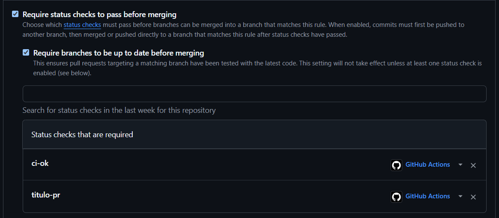

# Evidências: Aula 2, Integração Contínua

Seções do PGC aplicadas: 4.2 (nomenclatura), 5.1 (gatilhos), 5.2 (revisão) e 5.3 (quality gates).

## Rastreabilidade

| Item | Link |
|---|---|
| Issue de origem | [#13: ci: configurar integracao continua conforme Aula 2](https://github.com/arthurfaust/fundscope/issues/13) |
| Pull request do CI (mesclado por squash) | [#15](https://github.com/arthurfaust/fundscope/pull/15) → commit [`4d955f7`](https://github.com/arthurfaust/fundscope/commit/4d955f7075d4a21c2ed4fa52314565feb034d503) |
| Desvio de cobertura registrado | [#14: test: elevar cobertura de testes para 60%](https://github.com/arthurfaust/fundscope/issues/14) |

## Falhas provocadas de propósito

| # | Falha provocada | Check que falhou | Execução |
|---|---|---|---|
| 1 | Título do PR alterado para `ajustes` | `titulo-pr` | [job 136863230424](https://github.com/arthurfaust/fundscope/actions/runs/44909881890/job/136863230424) |
| 2 | Variável `nao_usada` em `validation/schema.py` (Ruff F841) | Qualidade e testes → Verificar qualidade | [job 136866260621](https://github.com/arthurfaust/fundscope/actions/runs/44910891522/job/136866260621) |
| 3 | Mensagem esperada alterada em `test_schema.py` | Qualidade e testes → Executar testes com cobertura | [job 136867844946](https://github.com/arthurfaust/fundscope/actions/runs/44911414171/job/136867844946) |

Cada falha foi corrigida no mesmo PR antes do merge.

## Falha real encontrada pelo pipeline

O job de análise de dependências falhou com `Forbidden` porque o *Dependency graph*
estava desligado no repositório. O `ci-ok` bloqueou o merge, como esperado. A correção foi
ativar o *Dependency graph* em Settings → Advanced Security e reexecutar o job.

| Check | Execução |
|---|---|
| Análise de dependências (SCA) | [job 136640808584](https://github.com/arthurfaust/fundscope/actions/runs/44838511407/job/136640808584) |
| `ci-ok` bloqueando o merge | [job 136641088448](https://github.com/arthurfaust/fundscope/actions/runs/44838511407/job/136641088448) |

## Configuração da proteção da `main`

Checks obrigatórios: somente `ci-ok` e `titulo-pr`, com *Require branches to be up to date*.

## Revisão

| Item | Link |
|---|---|
| Comentário do revisor (`ci.yml`, linha 57) | [mariagranza: "Por que 18% e não 60%?"](https://github.com/arthurfaust/fundscope/pull/15#discussion_r4652963901) |
| Resposta ao comentário | [arthurfaust: desvio registrado na #14](https://github.com/arthurfaust/fundscope/pull/15#discussion_r4652974234) |
| Aprovação | [mariagranza: Approved](https://github.com/arthurfaust/fundscope/pull/15#pullrequestreview-6005805197) |
| PR revisado no repositório do par | _pendente_ |
